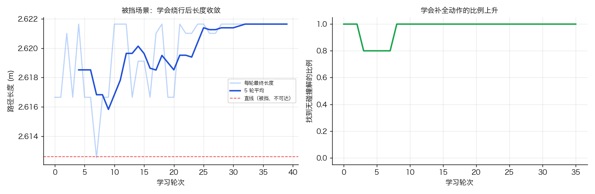

# 基础动作组合学习（Bacl）

> 通过**不完整的动作组合**，学习出更多可行的动作方式。

这不是"每步输出一个动作"的强化学习，而是**学怎么改自己的解**：
给一个残缺的动作组合（例如整条路径会撞障碍），用一个动作把它补全，
再继续压短、平滑，直到不再需要改。每一次改动都是"状态 → 动作 → 新状态"。

## 三分钟看懂

```
残缺组合（会撞）
   ↓ 加绕行动作          ← 学到：碰撞时用它（Q=25.1）
完整组合（不撞，但偏长）
   ↓ 投影到直线 / 短路    ← 学到：无碰撞时用它（Q=19.8）
更短组合
   ↓ 重解连续 IK         ← 学到：关节有突变时用它（Q=10.2）
最终组合
```

## 形式化

| 要素 | 对应 |
|---|---|
| **状态 s** | 当前组合：节点数、长度比、是否碰撞、最大关节增量 |
| **动作 a** | 加绕行动作 / 删节点 / 重解连续 IK / 投影到直线 / 短路 |
| **奖励 r** | 长度减少×20 + 解决碰撞+8 − 新增碰撞−3 − 关节突变−1 − 空动作−0.2 |
| **学习** | Q-learning：`Q(s,a) ← Q(s,a) + α[r + γ·max Q(s') − Q(s,a)]` |

## 五个动作

| 动作 | 作用 | 何时用 |
|---|---|---|
| **加绕行动作** | 整条路径鼓一个包（远离障碍），链式 IK 保证连续 | 碰撞时 |
| 删节点 | 去掉冗余节点 | 长度偏长 |
| 重解连续 IK | 上一节点做初值重解 | 有突变 |
| 投影到直线 | 节点末端投到起点—终点连线上 | 无碰撞但偏长 |
| 短路 | 跳过中间节点直连 | 有冗余段 |

## 结果

| 场景 | 直线 | 学习后 | 倍数 | 碰撞 |
|---|---|---|---|---|
| 直线可达 | 0.751 m | **0.751 m** | 1.00 | 无 |
| 被挡（2 个障碍） | 2.613 m（不可直达） | **2.622 m** | 1.003 | 无 |

被挡场景学到的策略：

| 状态 | 动作 | Q 值 |
|---|---|---|
| 节点 6 · 碰撞 | **加绕行动作** | **25.10** |
| 节点 5 · 碰撞 | **加绕行动作** | **17.84** |
| 节点 6 · 无碰撞 | 投影到直线 | 19.76 |
| 节点 5 · 无碰撞 | 重解连续 IK | 10.15 |



## 跑起来

```bash
pip install -r requirements.txt

python run_bacl.py      # 被挡场景：学习绕行，输出学习曲线
python show_rl.py       # 学习曲线 + 学到的策略表
python show_chain.py    # 关节连续性对比（突变 3.42 rad → 0.005 rad）
```

查看器（零依赖，直接打开）：

```bash
open viewer.html        # 需要同目录有 solve.json / bacl_solve.json
```

或用任意静态服务器。

## 三种节点（结构性前提）

| 类型 | 含义 | 是否搜索 |
|---|---|---|
| **固定位置** | 起点、终点 | 不搜索，直接满足 |
| **固定数量** | 节点数（机械臂关节/路径层数） | 不搜索，先验固定 |
| **不固定** | 每层的关节向量 + 段上叠加的动作 | 唯一搜索自由度 |

## 文件

| 文件 | 内容 |
|---|---|
| `bacl.py` | **核心**：五个动作 + Q-learning |
| `run_bacl.py` | 被挡场景训练 + 出图 |
| `show_rl.py` | 学习曲线 + 策略表 |
| `arm_env.py` | 六自由度机械臂环境（FK、球障碍、碰撞） |
| `chain_path.py` | 链式 IK（保证节点间关节连续，不突变） |
| `structured_search2.py` | 分层 DP 求解 |
| `structured_search3.py` | 节点固定 + 加动作 |
| `shorten.py` / `shorten2.py` | 截肢迭代 / 直线附近候选 |
| `ee_path.py` / `ee_solve.py` | 末端直线插值 / 末端空间绕行 |
| `straighten.py` | 节点投影到直线 |
| `ppo_torch.py` / `train.py` | PPO 对照实验（学不会严格到达） |
| `ppo.py` | numpy 手写 PPO（**失败**：梯度 NaN，保留作对照） |
| `viewer.html` | 零依赖 3D 查看器（拖拽旋转、播放、动作表） |

## 曾踩过的坑（保留在文档里）

1. **度量方式**：按关节空间量长度得 4.000 m，按末端直线只有 0.751 m —— 机器人走的是末端直线。
2. **碰撞判定不一致**：动作里用关节插值判撞、评估用末端直线判撞，导致绕行动作"以为不用绕"。
3. **接受规则写反**：`(not col2, L2) < (not col, L)` 让无碰撞解被拒绝，Q 表学对了但解没被采纳。
4. **关节突变**：每个节点独立解 IK 会跳到不同分支（实测跳 3.42 rad），必须链式求解。
5. **PPO 学不会**：250 轮训练后严格到达成功率 0/40，才转向结构化求解。

## 实例：倒车入库

`garage/` 里把 MATLAB `自动泊车` 的后轴自行车模型移植过来，用同样的"基本动作组合"学入库：

| 方法 | 结果 |
|---|---|
| Q-learning（12000 轮） | 严格成功率 **29%**（0.35 m/12°），示例轨迹 21 个动作、误差 0.26 m/3° |
| 束搜索（同一套动作） | **3/3 成功**，10–12 个动作，误差 <0.25 m |

结论：这个任务里"搜组合"比"学价值"更有效；更好的做法是束搜索找序列 → Q-learning 泛化。

详见 [garage/README.md](garage/README.md)。

## 适应性学习（非 PPO 类）

`docs/强化学习模板.md` 把"标准引导 + 迭代改良"固化成可复用循环。
**这不是 PPO 类强化学习，而是适应性学习**——学的是"该怎么改"，不是"该怎么做"：

```
标准方法 → 收集缺点样本 → 学规则 → 应用+验证 → 迭代
```

倒车入库实测：学到 7.5 个动作（标准 8.1），验证次数 10（穷举 103）——**同样短，快 10 倍**。

以后换任务只需替换三个空位：标准方法、动作特征、评估函数。

## 后续可以在这上面改

- 换动作集（比如加"焊接"、"抬升"、"分叉"）
- 换奖励（时间、能耗、平滑度）
- 换搜索器（Q 表 → 策略网络，即把这里当环境）
- 换机器人（改 `arm_env.py` 的 FK 与碰撞检测）

MIT License
