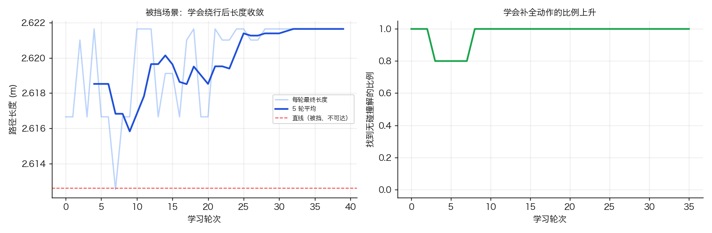

# 基础动作组合学习（Bacl）

> 通过**不完整的动作组合**，学习出更多可行的动作方式。

## 核心思想

一般强化学习学的是"每一步该输出什么动作"。
这里学的是**动作组合本身**：给一个残缺的组合（例如整条路径会撞障碍），
用一个动作把它补全、重组，得到一个新的组合，再继续改，直到不再需要改。

```
不完整的组合（会撞）
   ↓ 加绕行动作
完整组合（不撞，但可能偏长）
   ↓ 投影到直线 / 短路 / 删节点
更短的完整组合
   ↓ 重复
最终：满足约束且尽可能短的动作组合
```

## 形式化

| 要素 | 对应 |
|---|---|
| **状态 s** | 当前动作组合：节点数、长度比、是否碰撞、最大关节增量 |
| **动作 a** | 加绕行动作 / 删节点 / 重解连续 IK / 投影到直线 / 短路 |
| **奖励 r** | 长度减少 ×20 + 解决碰撞 +8 − 碰撞新增 −3 − 关节突变 −1 − 空动作 −0.2 |
| **学习** | Q-learning，学"什么状态该补哪种动作" |

## 五个动作

| 动作 | 作用 | 什么时候有用 |
|---|---|---|
| **加绕行动作** | 给整条路径鼓一个包（远离障碍），链式 IK 保证连续 | **碰撞时** |
| 删节点 | 去掉冗余节点 | 长度偏长时 |
| 重解连续 IK | 用上一节点做初值，重新解一遍 | 关节突变/碰撞时 |
| 投影到直线 | 把节点末端投到起点—终点连线上 | 无碰撞但偏长时 |
| 短路 | 跳过中间节点直接连 | 有冗余段时 |

## 学到的策略（被挡场景，2 个障碍）

| 状态 | 动作 | Q 值 |
|---|---|---|
| 节点 6 · **碰撞** | **加绕行动作** | **25.10** |
| 节点 5 · **碰撞** | **加绕行动作** | **17.84** |
| 节点 6 · 无碰撞 | 投影到直线 | 19.76 |
| 节点 5 · 无碰撞 | 重解连续 IK | 10.15 |
| 节点 4 · 无碰撞但有突变 | 短路 | 0.05 |

**策略完全可解释**：先补全（加绕行）→ 再压短（投影/短路）→ 再平滑（重解 IK）。

## 结果

| | 值 |
|---|---|
| 起点→终点直线 | 2.613 m（**被障碍挡住，不可直达**） |
| 学到的路径 | **2.622 m**（1.003 倍） |
| 碰撞 | 无 |
| 最大关节增量 | 0.069 rad |
| 学习轮次 | 40 轮；前 8 轮内就稳定找到无碰撞解 |



左图：长度收敛到 2.622 m（略高于 2.613 m，因为必须绕开障碍）。
右图：找到无碰撞解的比例从波动到 1.0。

## 文件

| 文件 | 内容 |
|---|---|
| `bacl.py` | 五个动作 + Q-learning 循环 |
| `run_bacl.py` | 在被挡场景上训练、出图 |
| `bacl_learning.png` | 学习曲线 |
| `bacl_qtable.json` | 学到的 Q 表 |
