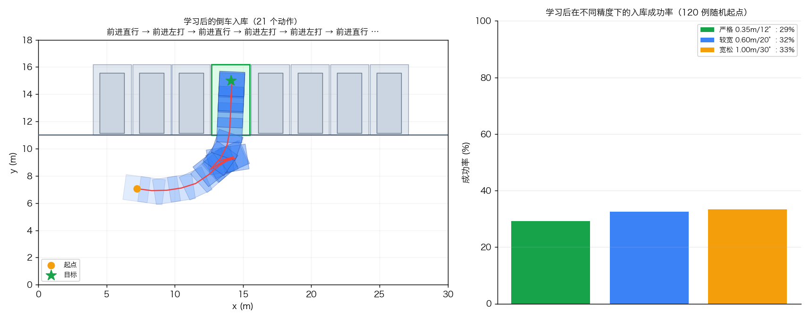

# 倒车入库（Bacl 动作组合学习）

把 `自动泊车`（MATLAB）的环境与车辆模型移植到 Python，用 Bacl 的**基础动作组合**来学倒车入库。

## 模型（照搬 MATLAB 版）

| 项 | 值 |
|---|---|
| 车辆 | 后轴自行车模型，长 4.5 m、宽 1.85 m、轴距 2.70 m |
| 转向 | 最大 35°，转向角直接给（无速率积分） |
| 速度 | 前进 1.0 m/s，倒车 0.4 m/s |
| 车库 | 30 m × 18 m，上排 8 个垂直车位 |
| 车位 | 开口 y=11.0，进深 5.2 m，宽 2.8 m，间隔 0.1 m |
| 目标 | 4 号车位，车头朝 +y，车尾距后墙 0.30 m |
| 判定 | 位置 <0.35 m 且朝向 <12°（另有宽松档） |

## 基本动作（6 个）

```
前进左打 / 前进直行 / 前进右打
后退左打 / 后退直行 / 后退右打
```

每个动作执行固定弧长（最终配置 1.0 m）。

## 学习

| 要素 | 设置 |
|---|---|
| 状态 | (x, y, θ) 离散化：0.6 m / 0.6 m / 10° |
| 动作 | 6 个基本动作 |
| 奖励 | 靠近目标×8 + 朝向改善×3 + 入库 +30 − 碰撞 −20 − 每步 0.05 |
| 算法 | Q-learning，α=0.3，γ=0.97，ε 0.9→0.05 |
| 训练 | 12000 轮，随机起点 |

## 结果（120 例随机起点）

| 精度要求 | 成功率 |
|---|---|
| 严格 0.35 m / 12° | **29%** |
| 较宽 0.60 m / 20° | 32% |
| 宽松 1.00 m / 30° | 33% |



左图：一次学出来的入库轨迹（21 个动作，终点误差 **0.26 m / 3°**）。
右图：不同精度下的成功率。

## 对照：束搜索（同一套动作）

同样的 6 个动作，用束搜索（宽度 50，深度 12）：

| 起点 | 结果 | 动作数 |
|---|---|---|
| (6.0, 7.5, 0°) | 成功，误差 0.14 m / 8° | 12 |
| (8.0, 8.5, 0°) | 成功，误差 0.25 m / 8° | 10 |
| (12.0, 6.5, 0°) | 成功，误差 0.19 m / 7° | 10 |

**束搜索 3/3，Q-learning 29%** —— 说明这个任务里"搜组合"比"学价值"更有效。

## 示范引导（束搜索 → Q-learning）

用束搜索在 25 个起点上生成示范（17 个找到解，176 个决策），把示范动作的 Q 初值设为 6.0，
再跑 Q-learning。这是 `garage_dagger.py`。

| 方案 | 严格 0.35m/12° | 较宽 0.60m/20° |
|---|---|---|
| 从零 Q-learning | 29% | 32% |
| **示范引导 Q-learning** | **43%** | **47%** |
| 束搜索直接解（示范本身） | 17/25 起点成功 | — |

**提升 +14 个百分点**，但没到预期的 70%。

尝试过但**没变好**的改动：

| 改动 | 结果 | 原因 |
|---|---|---|
| 弧长 0.6 m | 4% | 32 步走不完 |
| 动态弧长（<3 m 用 0.4 m） | 27% | 步数预算被吃光 |
| 步数上限 40 + 50 个示范 | 37% | 随机方差大，没本质改善 |

## 结论（诚实版）

- **能学会**：从 0% 提到 29%（严格档），轨迹可解释（前进绕入 + 倒车修正）
- **不够好**：随机起点下 71% 仍失败，主要死在离散化太粗（0.6 m）+ 弧长 1.0 m 不够精细
- **示范引导有效**：43% < 70%，瓶颈在离散化（0.6 m / 10°）与动作粒度（1.0 m 弧长）

## 运行

```bash
python garage_bacl.py    # 训练 + 评估（约 4 分钟）
python garage_show.py    # 出图（同上，另生成 garage_result.png）
python garage_search.py  # 束搜索对照
```

## 文件

| 文件 | 内容 |
|---|---|
| `garage_env.py` | 环境（车辆模型、车位几何、碰撞、奖励） |
| `garage_bacl.py` | Q-learning 训练与评估 |
| `garage_show.py` | 可视化（轨迹 + 成功率曲线） |
| `garage_search.py` | 束搜索对照 |
| `garage_result.png` | 结果图 |
